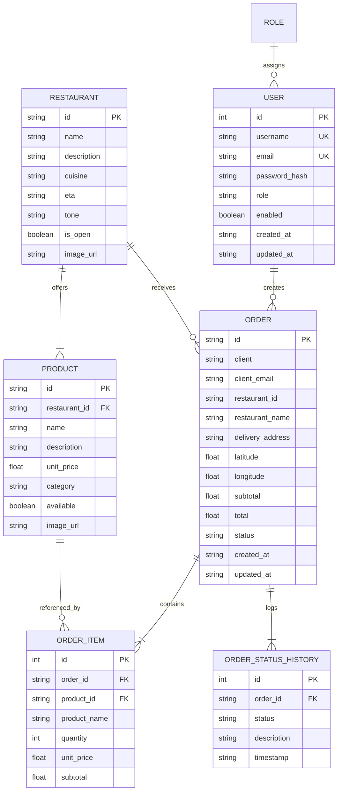

# 📋 Especificación del Proyecto — Chegô Monolith

## 1. Visión y Propósito

**Chegô** es una plataforma integral de delivery de comida y gestión de pedidos para restaurantes. El proyecto está construido bajo una arquitectura de **Monolito Modular Moderno**, combinando la robustez transaccional y de seguridad de **Spring Boot 3 (Java 17)** con la agilidad y experiencia de usuario dinámica de **React 18 con TypeScript y TailwindCSS**.

El objetivo técnico principal es minimizar la fricción operativa y los costos de infraestructura:
- Un solo artefacto desplegable (`jar` ejecutable o imagen Docker).
- Autenticación segura y desacoplada mediante tokens **JWT**.
- Base de datos ligera e incrustada con **SQLite** controlada por versionado estricto con **Flyway**.
- Servido de la Single Page Application (SPA) directamente desde el backend mediante `SpaForwardController` para habilitar *HTML5 History API* y refrescos de página transparentes.

---

## 2. Modelo de Dominio y Entidades

### Descripción de Entidades:

1. **User & Role**:
   - Usuarios registrados en el sistema.
   - Roles soportados: `ADMIN` (administrador) y `USER` (consumidor).
   - Contraseñas almacenadas como hash `BCrypt` (factor de costo 10).

2. **Restaurant**:
   - Establecimientos gastronómicos asociados.
   - Datos de contacto, categoría culinaria, indicador de apertura (`is_open`), tiempo promedio estimado (`eta`) y estilos cromáticos (`tone`) para tarjetas en la UI.

3. **Product**:
   - Platos, bebidas y complementos ofertados por un restaurante específico.
   - Precio unitario (`unit_price`), disponibilidad (`available`) y categoría de menú.

4. **Order & OrderItem**:
   - Cabecera del pedido que agrupa cliente, restaurante, dirección de entrega, geolocalización opcional, subtotal y total.
   - Los ítems del pedido conservan un snapshot del nombre y precio unitario al momento de la compra para garantizar consistencia histórica.

5. **OrderStatusHistory**:
   - Registro inmutable de cada cambio de estado por el que atraviesa el pedido, guardando marca de tiempo ISO y descripción explicativa para el cliente.

---

## 3. Máquina de Estados y Reglas de Negocio de Pedidos

El ciclo de vida del pedido se rige por un grafo finito administrado en `OrderService`:

### Transiciones Válidas (`VALID_TRANSITIONS`):
- `RECEBIDO` ➔ `CONFIRMADO`, `CANCELADO`
- `CONFIRMADO` ➔ `EM_PREPARO`, `CANCELADO`
- `EM_PREPARO` ➔ `PRONTO_PARA_RETIRADA`, `SAIU_PARA_ENTREGA`, `CANCELADO`
- `PRONTO_PARA_RETIRADA` ➔ `SAIU_PARA_ENTREGA`, `CANCELADO`
- `SAIU_PARA_ENTREGA` ➔ `ENTREGUE`, `CANCELADO`
- `ENTREGUE` ➔ *(Estado final inmutable)*
- `CANCELADO` ➔ *(Estado final inmutable)*

### Reglas de Negocio Esenciales:
1. **Idempotencia**: Si una solicitud intenta actualizar un pedido al mismo estado en el que ya se encuentra (e.g. reenvío de webhooks externos), el sistema responde exitosamente sin duplicar entradas en el historial.
2. **Inmutabilidad de Estados Finales**: Un pedido marcado como `ENTREGUE` o `CANCELADO` jamás puede reactivarse bajo ninguna circunstancia.
3. **Control de Cancelación**:
   - Los clientes (`ROLE_USER`) solo pueden cancelar sus propios pedidos mientras no hayan alcanzado el estado `ENTREGUE`.
   - Los administradores (`ROLE_ADMIN`) tienen facultades para cancelar pedidos en cualquier punto antes de la entrega final.
4. **Permisos de Transición**: Solo usuarios con `ROLE_ADMIN` o servicios de sistema autenticados pueden avanzar manualmente las fases de cocina y despacho (`PATCH /orders/{id}/status`).

---

## 4. Decisiones de Arquitectura y Tecnologías

### 4.1 Backend (Spring Boot 3.3.3)
- **Spring Security 6 & JJWT 0.12.6**: Filtro stateless `JwtAuthenticationFilter` en cadena antes de `UsernamePasswordAuthenticationFilter`. Manejo de 401 (`JwtAuthenticationEntryPoint`) y 403 (`JwtAccessDeniedHandler`).
- **Spring Data JPA & SQLite**: Se utiliza el driver JDBC `sqlite-jdbc` con `hibernate-community-dialects`. Permite desarrollo sin necesidad de montar un servidor de bases de datos externo.
- **Flyway**: Control riguroso de migraciones SQL en `src/main/resources/db/migration`. El baseline está configurado para permitir migraciones automáticas al iniciar la aplicación.
- **OpenAPI 3 / SpringDoc**: Generación automática de especificación Swagger en `/swagger-ui.html` para pruebas de QA e integración.
- **SpaForwardController**: Intercepta rutas de frontend (`/login`, `/cadastro`, `/pedidos/**`, `/restaurantes/**`) y hace `forward:/index.html`, evitando errores 404 al refrescar páginas directas en el navegador.

### 4.2 Frontend (React 18 + Vite + TailwindCSS)
- **Vite 8 & TypeScript**: Compilación extremadamente rápida, verificación estricta de tipos.
- **React Router DOM 6**: Enrutamiento protegido por componente `ProtectedRoute` que valida la presencia y expiración del token JWT.
- **Axios Interceptor**: Inyecta el header `Authorization: Bearer <token>` automáticamente en cada petición y redirecciona a login en caso de recibir respuestas `401 Unauthorized`.
- **Tailwind CSS 3.4**: Estilizado responsivo, paleta cromática gastronómica y diseño limpio con microinteracciones.

### 4.3 Empaquetado y Despliegue
- **Multi-Stage Dockerfile**:
  - `Stage 1 (Node 22)`: Compila el frontend (`npm run build`).
  - `Stage 2 (Maven 3.9 + Temurin 17)`: Integra los assets estáticos y compila el JAR del backend.
  - `Stage 3 (Temurin 17 JRE Jammy)`: Imagen final mínima, ejecuta la app con usuario seguro no root (`chego`).
- **Respeto a variable PORT**: Listo para plataformas en la nube (Render, Railway, Fly.io) que asignan el puerto dinámicamente mediante `$PORT`.

---

## 5. Hoja de Ruta (Roadmap) y Futuras Mejoras

- [ ] **WebSockets / Server-Sent Events (SSE)**: Actualizaciones en tiempo real del tracking de pedidos sin requerir polling HTTP periódico.
- [ ] **Perfil de Base de Datos PostgreSQL**: Crear perfil `application-prod.properties` con soporte alternativo para PostgreSQL cuando se requiera alta concurrencia.
- [ ] **Integración de Pasarela de Pagos**: Agregar soporte para Stripe / Pix / Mercado Pago en el flujo de `CreateOrderPage`.
- [ ] **Notificaciones Push / Email**: Integración con servicios de mensajería (SendGrid, WhatsApp API) para notificar cambios de estado del pedido.
