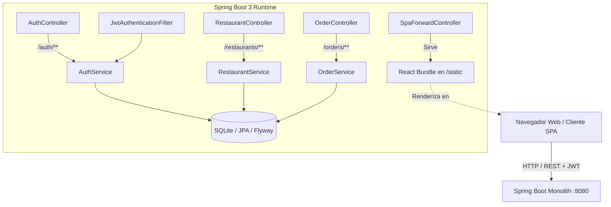
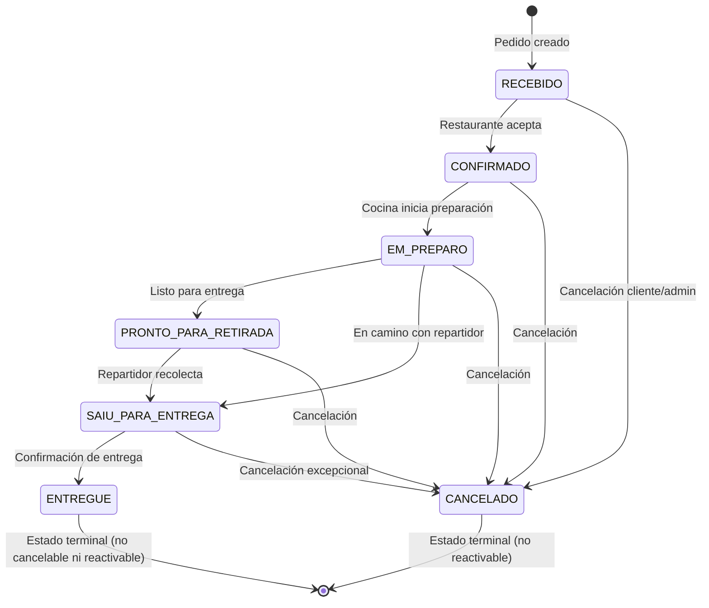

# 🍽️ Chegô Monolith — Plataforma de Pedidos & Delivery

[](https://spring.io/projects/spring-boot)
[](https://openjdk.org/)
[](https://react.dev/)
[](https://www.typescriptlang.org/)
[](https://vitejs.dev/)
[](https://tailwindcss.com/)
[](https://www.sqlite.org/)
[](https://www.docker.com/)

**Chegô** es una solución monolítica modular para delivery de comida rápida y restaurantes, compuesta por un **Backend en Spring Boot 3 con Java 17**, persistencia en **SQLite con Flyway** y un **Frontend SPA moderno en React 18 con Vite y TypeScript**. 

La aplicación está diseñada bajo el patrón de **Monolito Autónomo**: el frontend se compila e integra en los recursos estáticos del backend, permitiendo desplegar la solución completa en un único contenedor Docker liviano y eficiente.

---

## 📌 Tabla de Contenidos

- [Características Principales](#-características-principales)
- [Arquitectura del Sistema](#-arquitectura-del-sistema)
- [Credenciales por Defecto](#-credenciales-por-defecto)
- [Estructura del Proyecto](#-estructura-del-proyecto)
- [Requisitos Previos](#-requisitos-previos)
- [Inicio Rápido](#-inicio-rápido)
  - [Opción A: Ejecución con Docker (Recomendado)](#opción-a-ejecución-con-docker-recomendado)
  - [Opción B: Desarrollo Local (Frontend + Backend desacoplados)](#opción-b-desarrollo-local-frontend--backend-desacoplados)
  - [Opción C: Compilación Monolítica Completa con Maven](#opción-c-compilación-monolítica-completa-con-maven)
- [Endpoints y Documentación de la API](#-endpoints-y-documentación-de-la-api)
- [Máquina de Estados de Pedidos](#-máquina-de-estados-de-pedidos)
- [Variables de Entorno](#-variables-de-entorno)
- [Pruebas Automatizadas](#-pruebas-automatizadas)
- [Despliegue en Producción](#-despliegue-en-producción)

---

## 🚀 Características Principales

- 🔐 **Autenticación y Autorización Robusta**:
  - Tokens JWT sin estado (*stateless*) con expiración configurable.
  - Encriptación de contraseñas con **BCrypt**.
  - Control de acceso basado en roles (**ROLE_ADMIN** y **ROLE_USER**).
- 🏪 **Gestión de Restaurantes y Menús**:
  - Catálogo de restaurantes asociados con tiempos estimados de entrega y categorías.
  - Menú estructurado por secciones y productos con fotos y descripciones detalladas.
- 🛒 **Ciclo de Vida de Pedidos Completo**:
  - Creación dinámica de pedidos con cálculo automático de subtotales y totales.
  - Rastreamento en tiempo real con línea de tiempo histórica de estados.
  - Cancelación controlada (los clientes pueden cancelar antes de la entrega; los administradores pueden gestionar cualquier estado).
- 🎨 **Experiencia de Usuario (UI/UX) Moderna**:
  - React 18 con TypeScript y TailwindCSS.
  - Ruteo con React Router DOM y soporte para *deep-linking* gracias a `SpaForwardController`.
  - Iconografía con Lucide React y notificaciones contextuales tipo Toast.
- 🐳 **Contenedorización Optimizada**:
  - `Dockerfile` multi-etapa (*multi-stage build*) con imagen final sobre Eclipse Temurin JRE y usuario sin privilegios (*non-root*).

---

## 🏗️ Arquitectura del Sistema



---

## 🔑 Credenciales por Defecto

La base de datos se inicializa y puebla automáticamente mediante migraciones de **Flyway** (`V1__init_schema.sql` y `V2__seed_data.sql`). Puedes ingresar con las siguientes cuentas de prueba:

| Rol | Correo Electrónico | Contraseña | Permisos y Capacidades |
| :--- | :--- | :--- | :--- |
| **Administrador** | `admin@chego.com` | `admin1234` | Gestión global, cancelar cualquier pedido y avanzar estados de entrega (`PATCH /orders/{id}/status`). |
| **Consumidor** | `user@chego.com` | `user1234` | Explorar restaurantes, crear pedidos, rastrear pedidos y cancelar pedidos propios antes de la entrega. |

---

## 📂 Estructura del Proyecto

```text
chego-auth/
├── .agents/                      # Configuración, guías y skills para agentes de IA
│   └── skills/                   # Runbooks y procedimientos modulares
│       ├── chego-backend-dev/    # Procedimientos para Spring Boot, Maven y SQLite
│       ├── chego-frontend-dev/   # Procedimientos para React, Vite y Tailwind
│       └── chego-docker-deploy/  # Procedimientos para Docker y despliegue
├── frontend/                     # Módulo Frontend (React + Vite + TypeScript)
│   ├── src/
│   │   ├── auth/                 # Contexto de autenticación, adapters y tokens
│   │   ├── components/           # Componentes UI reutilizables (Navbar, Layout, Toast)
│   │   ├── pages/                # Páginas (Login, Register, Orders, CreateOrder, etc.)
│   │   ├── routes/               # Configuración de React Router y ProtectedRoute
│   │   └── services/             # Clientes Axios y llamadas a endpoints
│   ├── package.json              # Dependencias de npm
│   ├── pom.xml                   # Configuración para frontend-maven-plugin
│   └── vite.config.ts            # Configuración de compilación Vite
├── security-server/              # Módulo Backend (Spring Boot 3.3.3)
│   ├── src/
│   │   ├── main/java/com/clon/security/
│   │   │   ├── config/           # Spring Security, JWT Filter, CORS, OpenAPI
│   │   │   ├── controller/       # AuthController, OrderController, RestaurantController, SpaForwardController
│   │   │   ├── entity/           # Entidades JPA (User, Order, Restaurant, Product, etc.)
│   │   │   ├── repositories/     # Spring Data JPA Repositories
│   │   │   └── service/          # Lógica de negocio y máquina de estados
│   │   └── resources/
│   │       ├── application.properties
│   │       └── db/migration/     # Scripts de migración Flyway (V1 y V2)
│   ├── pom.xml                   # Dependencias de Spring Boot, JJWT, SQLite, etc.
│   └── chego.db                  # Base de datos SQLite local
├── Dockerfile                    # Multi-stage build (Node 22 + Maven 3.9 + Temurin 17 JRE)
├── pom.xml                       # POM raíz de agregación Maven multi-módulo
├── AGENTS.md                     # Directrices para agentes inteligentes y LLMs
├── PROJECT.md                    # Especificación técnica detallada y arquitectura
└── README.md                     # Documentación principal del proyecto
```

---

## 💻 Requisitos Previos

Si deseas compilar o ejecutar el proyecto localmente sin Docker:
- **Java JDK 17** o superior (Eclipse Temurin, OpenJDK o Corretto recomendado).
- **Node.js 20+** o **Node.js 22** y **npm 10+**.
- **Maven 3.9+** (o utilizar el wrapper incluido `./mvnw` / `mvnw.cmd`).
- *(Opcional)* **Docker** (para la opción en contenedor).

---

## ⚡ Inicio Rápido

### Opción A: Ejecución con Docker (Recomendado)

Construye y corre la solución monolítica completa en un único paso:

```bash
# 1. Construir la imagen Docker
docker build -t chego-app .

# 2. Ejecutar el contenedor mapeando el puerto 8080
docker run -p 8080:8080 chego-app
```

Abre tu navegador en:
- **Aplicación Web**: [http://localhost:8080](http://localhost:8080)
- **Swagger / OpenAPI UI**: [http://localhost:8080/swagger-ui.html](http://localhost:8080/swagger-ui.html)

---

### Opción B: Desarrollo Local (Frontend + Backend desacoplados)

Ideal para flujo de desarrollo rápido con recarga en caliente (*Hot Module Replacement*):

#### 1. Iniciar el Backend (Terminal 1)
```bash
cd security-server
./mvnw spring-boot:run
# En Windows PowerShell / CMD:
# .\mvnw.cmd spring-boot:run
```
*El backend iniciará en el puerto `8080` y creará/migrará la base de datos `chego.db` automáticamente.*

#### 2. Iniciar el Frontend (Terminal 2)
```bash
cd frontend
npm install
npm run dev
```
*Vite levantará el servidor de desarrollo en `http://localhost:5173`. En modo desarrollo, las peticiones hacia la API se redirigen a `http://localhost:8080` de forma transparente.*

---

### Opción C: Compilación Monolítica Completa con Maven

Puedes compilar todo el proyecto (Node/React se compila a través de Maven y se empaqueta dentro del JAR del backend):

```bash
# Desde la raíz del repositorio:
./mvnw clean package -DskipTests
# En Windows:
# .\mvnw.cmd clean package -DskipTests

# Ejecutar el fat-JAR resultante:
java -jar security-server/target/security-server-0.0.1-SNAPSHOT.jar
```

---

## 📡 Endpoints y Documentación de la API

La especificación interactiva OpenAPI 3 / Swagger está disponible en:
👉 **`http://localhost:8080/swagger-ui.html`** (o `http://localhost:8080/swagger-ui/index.html`)

### Resumen de Endpoints Principales:

#### 🔐 Autenticación (`/auth`)
| Método | Endpoint | Acceso | Descripción |
| :--- | :--- | :--- | :--- |
| `POST` | `/auth/login` | Público | Autentica con correo y contraseña. Devuelve token JWT y datos de usuario. |
| `POST` | `/auth/register` | Público | Registra un nuevo usuario consumidor con contraseña encriptada en BCrypt. |
| `GET` | `/auth/verify` | Autenticado | Valida la validez del token JWT y la sesión del usuario. |

#### 🍽️ Restaurantes y Menús (`/restaurants`)
| Método | Endpoint | Acceso | Descripción |
| :--- | :--- | :--- | :--- |
| `GET` | `/restaurants` | Autenticado | Lista todos los restaurantes asociados y disponibles. |
| `GET` | `/restaurants/{id}` | Autenticado | Obtiene la información detallada de un restaurante. |
| `GET` | `/restaurants/{id}/menu`| Autenticado | Obtiene el menú categorizado y la lista de platos/productos. |
| `GET` | `/restaurants/{id}/products/{productId}` | Autenticado | Consulta detalles y precio de un producto específico. |

#### 📦 Pedidos (`/orders`)
| Método | Endpoint | Acceso | Descripción |
| :--- | :--- | :--- | :--- |
| `GET` | `/orders` | Autenticado | Lista todos los pedidos ordenados de forma descendente por fecha. |
| `GET` | `/orders/{id}` | Autenticado | Obtiene el detalle completo de un pedido con sus ítems e historial. |
| `GET` | `/orders/{id}/status` | Autenticado | Obtiene únicamente el estado actual y línea de tiempo de rastreo. |
| `POST` | `/orders` | Autenticado | Registra un nuevo pedido calculando subtotales, totales y registrando estado inicial `RECEBIDO`. |
| `POST` | `/orders/{id}/cancel` | Autenticado | Cancela un pedido activo. Admite motivo opcional en el cuerpo JSON. |
| `PATCH`| `/orders/{id}/status` | **ADMIN** | Transiciona el estado del pedido siguiendo el grafo de la máquina de estados. |

---

## 🔄 Máquina de Estados de Pedidos

El ciclo de vida de los pedidos implementa validaciones estrictas de transición para evitar estados inconsistentes:



> **Reglas de Negocio Clave:**
> 1. Un pedido en estado `ENTREGUE` o `CANCELADO` es **terminal**: no puede reabrirse ni modificarse.
> 2. Las transiciones de avance de estado son idempotentes (repetir el mismo estado no genera duplicados).
> 3. Cada transición registra automáticamente un evento en la tabla `order_status_history`.

---

## ⚙️ Variables de Entorno

Puedes personalizar la configuración mediante variables de entorno en tu archivo `.env`, servicio de hosting o comando Docker:

| Variable | Valor por Defecto | Descripción |
| :--- | :--- | :--- |
| `PORT` | `8080` | Puerto HTTP donde escuchará el servidor Spring Boot. |
| `SPRING_DATASOURCE_URL` | `jdbc:sqlite:chego.db` | URL JDBC para SQLite u otra base de datos compatible. |
| `JWT_SECRET` | *Clave interna de 256 bits* | Secreto HMAC para firmar y validar tokens JWT. Reemplazar en producción. |
| `JWT_EXPIRATION_MS` | `86400000` (24 horas) | Tiempo de expiración del token en milisegundos. |
| `CORS_ALLOWED_ORIGINS` | `http://localhost:5173,http://localhost:3000...` | Orígenes permitidos para peticiones cruzadas en desarrollo. |
| `VITE_API_BASE_URL` | *(vacío en prod, `http://localhost:8080/` en dev)* | URL base de la API para el cliente React. |

---

## 🧪 Pruebas Automatizadas

### Backend:
Para ejecutar la suite de pruebas unitarias y de integración de Spring Boot:
```bash
# Desde la raíz del repositorio (resuelve automáticamente las dependencias entre módulos):
./mvnw test -pl security-server -am
# En Windows:
.\mvnw.cmd test -pl security-server -am
```
*Incluye pruebas para el ciclo de vida de pedidos, restricciones de cancelaciones, idempotencia y prevención de reactivaciones irregulares (`OrderCancellationAndTrackingTests.java`).*

### Frontend:
Para validar el tipado estático con TypeScript:
```bash
cd frontend
npm run typecheck
```

---

## 🌐 Despliegue en Producción

El proyecto está 100% preparado para plataformas en la nube tipo PaaS como **Render**, **Railway**, **Fly.io** o **AWS ECS / DigitalOcean**:

1. **Build con Dockerfile**: Apunta la configuración de despliegue al `Dockerfile` raíz.
2. **Variable de Puerto**: Plataformas como Render asignan dinámicamente la variable `PORT`. El `Dockerfile` y `application.properties` ya están configurados para respetarla.
3. **Persistencia de SQLite**: Si despliegas con SQLite, vincula un volumen persistente para evitar perder la base de datos entre reinicios, o configura `SPRING_DATASOURCE_URL` hacia una base PostgreSQL/MySQL configurando su respectivo driver.

---

## 👥 Contribuciones y Desarrollo con Agentes de IA

Este repositorio incluye especificaciones completas para agentes inteligentes y LLMs:
- Consulta **[AGENTS.md](./AGENTS.md)** para directrices de codificación y diseño.
- Consulta **[PROJECT.md](./PROJECT.md)** para el diseño de dominio y arquitectura en profundidad.
- Consulta las **Skills** en [`.agents/skills/`](./.agents/skills/) para procedimientos operativos estándar.
