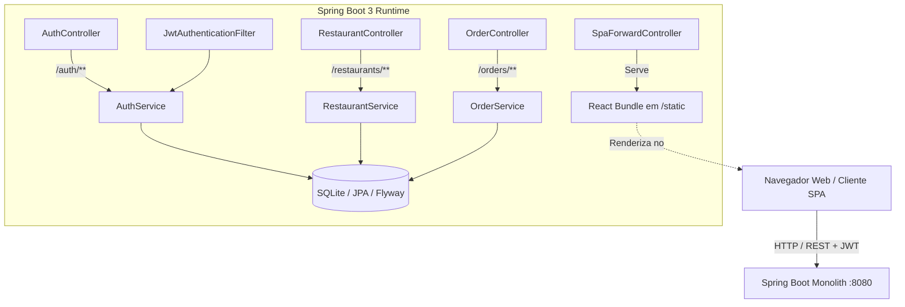
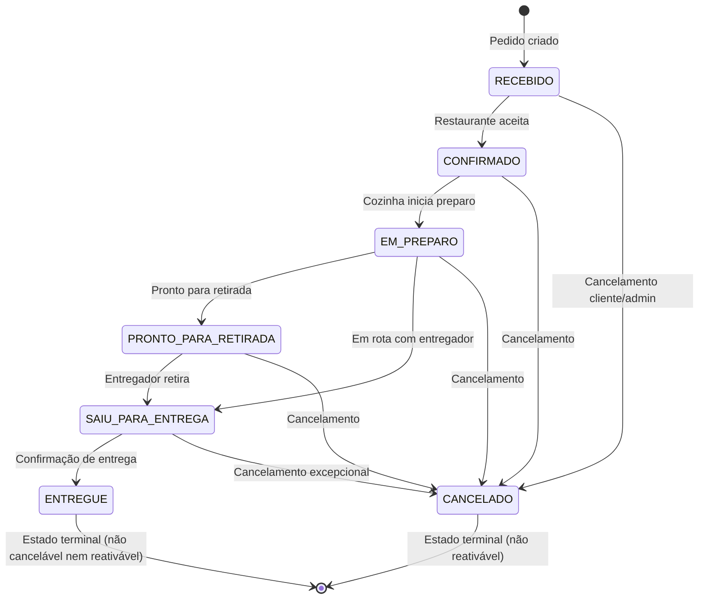

# 🍽️ Chegô Monolith — Plataforma de Pedidos & Delivery

[ 🇪🇸 Versión en Español ](README.md) | [ 🇧🇷 Versão em Português ](README.pt-BR.md)

[](https://spring.io/projects/spring-boot)
[](https://openjdk.org/)
[](https://react.dev/)
[](https://www.typescriptlang.org/)
[](https://vitejs.dev/)
[](https://tailwindcss.com/)
[](https://www.sqlite.org/)
[](https://www.docker.com/)

**Chegô** é uma solução monolítica modular completa para delivery e gerenciamento de pedidos de restaurantes, composta por um **Backend em Spring Boot 3 com Java 17**, persistência em **SQLite com Flyway** e um **Frontend SPA moderno em React 18 com Vite e TypeScript**.

A aplicação segue o padrão de **Monólito Autônomo**: o frontend é compilado e integrado aos recursos estáticos do backend, viabilizando o deploy da solução completa em um único contêiner Docker leve, seguro e eficiente.

---

## 📌 Índice

- [Funcionalidades Principais](#-funcionalidades-principais)
- [Arquitetura do Sistema](#-arquitetura-do-sistema)
- [Credenciais Padrão](#-credenciais-padrão)
- [Estrutura do Projeto](#-estrutura-do-projeto)
- [Pré-requisitos](#-pré-requisitos)
- [Início Rápido](#-início-rápido)
  - [Opção A: Execução com Docker (Recomendado)](#opção-a-execução-com-docker-recomendado)
  - [Opção B: Desenvolvimento Local (Frontend + Backend desacoplados)](#opção-b-desenvolvimento-local-frontend--backend-desacoplados)
  - [Opção C: Compilação Monolítica Completa com Maven](#opção-c-compilação-monolítica-completa-com-maven)
- [Endpoints e Documentação da API](#-endpoints-e-documentação-da-api)
- [Máquina de Estados dos Pedidos](#-máquina-de-estados-dos-pedidos)
- [Variáveis de Ambiente](#-variáveis-de-ambiente)
- [Testes Automatizados](#-testes-automatizados)
- [Deploy em Produção](#-deploy-em-produção)

---

## 🚀 Funcionalidades Principais

- 🔐 **Autenticação e Autorização Segura**:
  - Tokens JWT sem estado (*stateless*) com expiração configurável.
  - Criptografia de senhas com **BCrypt**.
  - Controle de acesso baseado em papéis (**ROLE_ADMIN** e **ROLE_USER**).
- 🏪 **Gestão de Restaurantes e Cardápios**:
  - Catálogo de restaurantes parceiros com tempo estimado de entrega (ETA) e categorias.
  - Cardápio organizado por categorias e produtos com fotos e descrições detalhadas.
- 🛒 **Ciclo de Vida Completo de Pedidos**:
  - Criação dinâmica de pedidos com cálculo automático de subtotais e valor total.
  - Rastreamento em tempo real com histórico cronológico de transições de status.
  - Cancelamento controlado (clientes podem cancelar antes da entrega; administradores têm controle irrestrito).
- 🎨 **Experiência do Usuário (UI/UX) Moderna**:
  - React 18 com TypeScript estrito e TailwindCSS.
  - Roteamento com React Router DOM e suporte a *deep-linking* via `SpaForwardController`.
  - Ícones da biblioteca Lucide React e notificações contextuais de feedback (*Toast notifications*).
- 🐳 **Contêiner Otimizado**:
  - `Dockerfile` multi-etapa (*multi-stage build*) com imagem final baseada em Eclipse Temurin JRE e execução com usuário seguro não-root (`chego`).

---

## 🏗️ Arquitetura do Sistema



---

## 🔑 Credenciais Padrão

O banco de dados é inicializado e populado automaticamente por meio das migrações do **Flyway** (`V1__init_schema.sql` e `V2__seed_data.sql`). Você pode acessar o sistema utilizando as seguintes credenciais pré-configuradas:

| Perfil | E-mail | Senha | Permissões e Capacidades |
| :--- | :--- | :--- | :--- |
| **Administrador** | `admin@chego.com` | `admin1234` | Gestão irrestrita, cancelamento de qualquer pedido e avanço manual de etapas de entrega (`PATCH /orders/{id}/status`). |
| **Consumidor** | `user@chego.com` | `user1234` | Navegação pelos restaurantes parceiros, criação de pedidos, acompanhamento de rastreio e cancelamento de pedidos próprios antes da entrega. |

---

## 📂 Estrutura do Projeto

```text
chego-auth/
├── .agents/                      # Configurações, diretrizes e skills para agentes de IA
│   └── skills/                   # Runbooks e procedimentos operacionais
│       ├── chego-backend-dev/    # Procedimentos para Spring Boot, Maven e SQLite
│       ├── chego-frontend-dev/   # Procedimentos para React, Vite e Tailwind
│       └── chego-docker-deploy/  # Procedimentos para Docker e deploy na nuvem
├── frontend/                     # Módulo Frontend (React + Vite + TypeScript)
│   ├── src/
│   │   ├── auth/                 # Contexto de autenticação, adaptadores e tokens
│   │   ├── components/           # Componentes visuais reutilizáveis (Layout, Loading, etc.)
│   │   ├── pages/                # Páginas (Login, Cadastro, Pedidos, Novo Pedido, etc.)
│   │   ├── routes/               # Configuração do React Router e ProtectedRoute
│   │   └── services/             # Instância do Axios e integração com a API REST
│   ├── package.json              # Dependências npm
│   ├── pom.xml                   # Configuração do frontend-maven-plugin
│   └── vite.config.ts            # Configurações do Vite
├── security-server/              # Módulo Backend (Spring Boot 3.3.3)
│   ├── src/
│   │   ├── main/java/com/clon/security/
│   │   │   ├── config/           # Spring Security, JwtFilter, CORS, OpenAPI
│   │   │   ├── controller/       # AuthController, OrderController, RestaurantController, SpaForwardController
│   │   │   ├── entity/           # Entidades JPA (User, Order, Restaurant, Product, etc.)
│   │   │   ├── repositories/     # Interfaces Spring Data JPA
│   │   │   └── service/          # Regras de negócio e máquina de estados
│   │   └── resources/
│   │       ├── application.properties
│   │       └── db/migration/     # Scripts Flyway (V1 e V2)
│   ├── pom.xml                   # Dependências do Spring Boot, JJWT, SQLite, etc.
│   └── chego.db                  # Arquivo do banco de dados SQLite local
├── Dockerfile                    # Multi-stage build (Node 22 + Maven 3.9 + Temurin 17 JRE)
├── pom.xml                       # POM raiz multi-módulos do Maven
├── AGENTS.md                     # Diretrizes de arquitetura para agentes e LLMs
├── PROJECT.md                    # Especificação técnica detalhada
├── README.md                     # Documentação principal (Espanhol)
└── README.pt-BR.md               # Documentação completa em Português
```

---

## 💻 Pré-requisitos

Para compilar ou executar o projeto localmente sem Docker:
- **Java JDK 17** ou superior (Eclipse Temurin, OpenJDK ou Amazon Corretto).
- **Node.js 20+** ou **Node.js 22** e **npm 10+**.
- **Maven 3.9+** (ou utilizar o wrapper incluso `./mvnw` / `mvnw.cmd`).
- *(Opcional)* **Docker** (para execução em contêiner único).

---

## ⚡ Início Rápido

### Opção A: Execução com Docker (Recomendado)

Compile e execute o monolito completo com um único comando:

```bash
# 1. Construir a imagem Docker
docker build -t chego-app .

# 2. Executar o contêiner mapeando a porta 8080
docker run -p 8080:8080 chego-app
```

Acesse em seu navegador:
- **Aplicação Web**: [http://localhost:8080](http://localhost:8080)
- **Documentação Interativa Swagger / OpenAPI**: [http://localhost:8080/swagger-ui.html](http://localhost:8080/swagger-ui.html)

---

### Opção B: Desenvolvimento Local (Frontend + Backend desacoplados)

Ideal para desenvolvimento ágil com recarregamento em tempo real (*Hot Module Replacement*):

#### 1. Iniciar o Backend (Terminal 1)
```bash
# A partir da raiz do repositório:
./mvnw spring-boot:run -pl security-server
# No Windows PowerShell:
.\mvnw.cmd spring-boot:run -pl security-server
```
*O backend inicializará na porta `8080` e executará as migrações do SQLite automaticamente.*

#### 2. Iniciar o Frontend (Terminal 2)
```bash
cd frontend
npm install
npm run dev
```
*O Vite iniciará o servidor de desenvolvimento em `http://localhost:5173`. Em modo de desenvolvimento, as requisições para a API são encaminhadas transparentemente para `http://localhost:8080`.*

---

### Opção C: Compilação Monolítica Completa com Maven

Você pode compilar todo o projeto via Maven (o React será compilado e empacotado dentro do JAR do backend):

```bash
# A partir da raiz do repositório:
./mvnw clean package -pl security-server -am -DskipTests
# No Windows PowerShell:
.\mvnw.cmd clean package -pl security-server -am -DskipTests

# Executar o JAR autônomo gerado:
java -jar security-server/target/security-server-0.0.1-SNAPSHOT.jar
```

---

## 📡 Endpoints e Documentação da API

A documentação interativa Swagger / OpenAPI 3 está disponível em:
👉 **`http://localhost:8080/swagger-ui.html`**

### Resumo dos Principais Endpoints:

#### 🔐 Autenticação (`/auth`)
| Método | Endpoint | Acesso | Descrição |
| :--- | :--- | :--- | :--- |
| `POST` | `/auth/login` | Público | Autentica com e-mail e senha. Retorna o token JWT e dados do usuário. |
| `POST` | `/auth/register` | Público | Registra um novo consumidor com senha criptografada em BCrypt. |
| `GET` | `/auth/verify` | Autenticado | Valida a integridade do token JWT e da sessão atual. |

#### 🍽️ Restaurantes e Cardápios (`/restaurants`)
| Método | Endpoint | Acesso | Descrição |
| :--- | :--- | :--- | :--- |
| `GET` | `/restaurants` | Autenticado | Retorna a lista completa de restaurantes parceiros disponíveis. |
| `GET` | `/restaurants/{id}` | Autenticado | Obtém os detalhes de um estabelecimento específico. |
| `GET` | `/restaurants/{id}/menu`| Autenticado | Retorna o cardápio oficial estruturado por categorias e produtos. |
| `GET` | `/restaurants/{id}/products/{productId}` | Autenticado | Consulta dados e preço unitário de um produto específico. |

#### 📦 Pedidos (`/orders`)
| Método | Endpoint | Acesso | Descrição |
| :--- | :--- | :--- | :--- |
| `GET` | `/orders` | Autenticado | Lista todos os pedidos ordenados por data decrescente. |
| `GET` | `/orders/{id}` | Autenticado | Retorna detalhes completos do pedido, itens e histórico. |
| `GET` | `/orders/{id}/status` | Autenticado | Retorna apenas o status atual e linha do tempo de rastreio. |
| `POST` | `/orders` | Autenticado | Cria um novo pedido com validação de itens, cálculo de totais e status `RECEBIDO`. |
| `POST` | `/orders/{id}/cancel` | Autenticado | Cancela um pedido ativo. Aceita justificativa opcional no corpo da requisição. |
| `PATCH`| `/orders/{id}/status` | **ADMIN** | Transiciona o status do pedido de acordo com o grafo da máquina de estados. |

---

## 🔄 Máquina de Estados dos Pedidos

O ciclo de vida dos pedidos aplica regras estritas de transição para evitar inconsistências:



> **Regras de Negócio Fundamentais:**
> 1. Pedidos nos estados `ENTREGUE` ou `CANCELADO` são **terminais**: nunca podem ser reabertos ou alterados.
> 2. Transições para o mesmo estado são idempotentes (não geram registros duplicados no histórico).
> 3. Cada transição registra automaticamente um evento com data e descrição na tabela `order_status_history`.

---

## ⚙️ Variáveis de Ambiente

As configurações podem ser customizadas por meio de variáveis de ambiente:

| Variável | Valor Padrão | Descrição |
| :--- | :--- | :--- |
| `PORT` | `8080` | Porta HTTP utilizada pelo servidor Spring Boot. |
| `SPRING_DATASOURCE_URL` | `jdbc:sqlite:chego.db` | URL JDBC de conexão com o banco de dados. |
| `JWT_SECRET` | *Chave de 256 bits padrão* | Segredo HMAC para assinatura e validação dos tokens JWT. |
| `JWT_EXPIRATION_MS` | `86400000` (24 horas) | Tempo de expiração do token JWT em milissegundos. |
| `CORS_ALLOWED_ORIGINS` | `http://localhost:5173,http://localhost:3000...` | Origens CORS permitidas para requisições em ambiente de desenvolvimento. |
| `VITE_API_BASE_URL` | *(vazio em prod, `http://localhost:8080/` em dev)* | URL base da API utilizada pelo frontend React. |

---

## 🧪 Testes Automatizados

### Backend:
Para executar os testes unitários e de integração do Spring Boot:
```bash
# A partir da raiz do repositório:
./mvnw test -pl security-server -am
# No Windows PowerShell:
.\mvnw.cmd test -pl security-server -am
```
*Cobre validações completas do ciclo de vida, idempotência, restrições de cancelamento e segurança contra reativações indevidas (`OrderCancellationAndTrackingTests.java`).*

### Frontend:
Para validar a tipagem estática do código TypeScript:
```bash
cd frontend
npm run typecheck
```

---

## 🌐 Deploy em Produção

A aplicação está pronta para publicação em plataformas em nuvem como **Render**, **Railway**, **Fly.io** ou **AWS**:

1. **Compilação com Dockerfile**: Aponte a configuração de deploy para o `Dockerfile` na raiz do repositório.
2. **Porta Dinâmica**: Plataformas como o Render injetam a variável `$PORT`. A aplicação está configurada para vincular a porta automaticamente no `ENTRYPOINT`.
3. **Persistência de Dados**: Caso utilize SQLite em produção, monte um volume persistente para reter o arquivo `chego.db`, ou configure `SPRING_DATASOURCE_URL` apontando para uma instância PostgreSQL/MySQL.

---

## 👥 Desenvolvimento com Agentes de IA

Este repositório possui diretrizes dedicadas para agentes inteligentes e assistentes de código:
- Veja **[AGENTS.md](./AGENTS.md)** para regras de codificação, padrões e restrições.
- Veja **[PROJECT.md](./PROJECT.md)** para a especificação técnica aprofundada de domínio.
- Veja as **Skills** em [`.agents/skills/`](./.agents/skills/) com procedimentos padrão de desenvolvimento.
